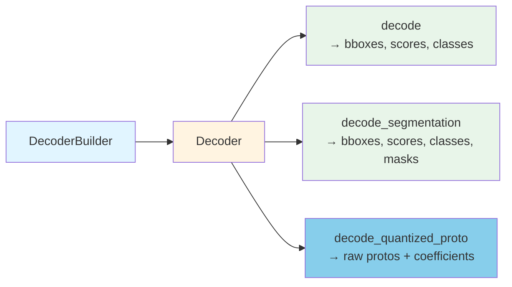
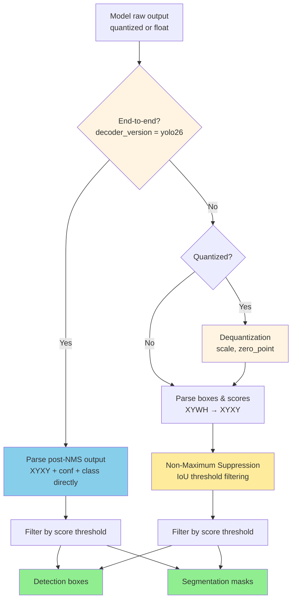
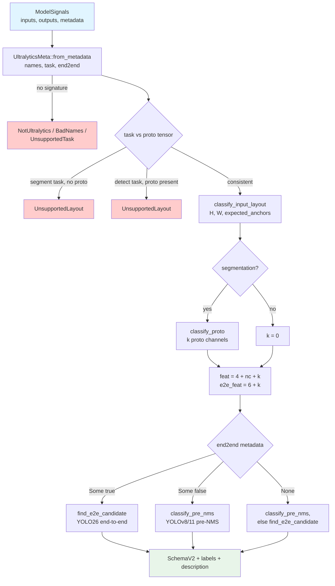

# edgefirst-decoder Architecture

## Overview

`edgefirst-decoder` is the post-processing layer that turns raw inference
outputs from object-detection and segmentation models into typed
`DetectBox` and `Segmentation` values. It supports both floating-point and
quantized (int8 / uint8) inputs without an intermediate dequantization
buffer for boxes and scores (int8 segmentation protos also stay raw; other
integer protos are dequantized once to f32), configurable NMS modes, end-to-end YOLOv26 models with embedded NMS,
and a fused proto-mask GPU rendering path that bypasses CPU mask
materialization. The crate is configured through a single
[`DecoderBuilder`](https://docs.rs/edgefirst-decoder/latest/edgefirst_decoder/struct.DecoderBuilder.html)
that ingests JSON or YAML model metadata and selects the right code path
based on the output tensor layout.

## Module Map

| Module | Source | Responsibility |
|--------|--------|----------------|
| [`lib.rs`](https://github.com/EdgeFirstAI/hal/blob/main/crates/decoder/src/lib.rs) | local | Public surface: `Decoder`, `DetectBox`, `Segmentation`, `Quantization`, `BoundingBox`, dequantize utilities |
| [`decoder/`](https://github.com/EdgeFirstAI/hal/blob/main/crates/decoder/src/decoder/) | local | `DecoderBuilder`, `ConfigOutputs`, model-type selection, per-scale bridge, post-processing |
| [`yolo.rs`](https://github.com/EdgeFirstAI/hal/blob/main/crates/decoder/src/yolo.rs) | local | YOLOv5/8/11 detection + segmentation kernels |
| [`modelpack.rs`](https://github.com/EdgeFirstAI/hal/blob/main/crates/decoder/src/modelpack.rs) | local | Au-Zone ModelPack format kernels |
| [`per_scale/`](https://github.com/EdgeFirstAI/hal/blob/main/crates/decoder/src/per_scale/) | local | Per-scale split-tensor decoder framework (NEON-optimized hot path): plan, pipeline, level kernels, outputs, score prefilter (`prefilter.rs`) and the 8-bit score table (`score_lut.rs`) |
| [`semantic/`](https://github.com/EdgeFirstAI/hal/blob/main/crates/decoder/src/semantic/) | local | Semantic segmentation: score map or class map to an `[H, W]` class map in a caller tensor, with content-region crop, bilinear or nearest upsampling and optional confidence |
| [`schema.rs`](https://github.com/EdgeFirstAI/hal/blob/main/crates/decoder/src/schema.rs) | local | `SchemaV2` parser — model metadata document used by EdgeFirst Studio |
| [`infer.rs`](https://github.com/EdgeFirstAI/hal/blob/main/crates/decoder/src/infer.rs) | local | `infer_ultralytics_schema` — synthesizes a `SchemaV2` for vanilla Ultralytics YOLOv8/11/26 ONNX/TFLite/CoreML exports from raw `ModelSignals` (tensor shapes/dtypes + the model's own metadata), with no `edgefirst.json` required |
| [`model_config/`](https://github.com/EdgeFirstAI/hal/blob/main/crates/decoder/src/model_config/) | local | Model configuration discovery: container readers (`onnx.rs` protobuf field walk, `ziptrailer.rs` behind `model-files`, `container.rs` sidecars), Hugging Face configs (`hf.rs`), tensor-name heuristics and semantic schema synthesis (`heuristics.rs`), override grammar (`overrides.rs`), provenance vocabularies (`provenance.rs`), and the resolver (`resolve.rs`) producing `ResolvedModelConfig` |
| [`float.rs`](https://github.com/EdgeFirstAI/hal/blob/main/crates/decoder/src/float.rs) / [`byte.rs`](https://github.com/EdgeFirstAI/hal/blob/main/crates/decoder/src/byte.rs) | local | NMS implementations (float and byte-quantized); `float.rs` also holds the IoU/IoS metric helpers reused by tiled merge |
| [`tiling.rs`](https://github.com/EdgeFirstAI/hal/blob/main/crates/decoder/src/tiling.rs) | local | SAHI output side: shared `TilePlacement` contract, `MatchMetric`/`MergeMode`/`MergeConfig`, `lift_tile_boxes`, greedy `merge_tiled_detections` (keep-best by default, enclosing union opt-in), and the streaming `TiledFrameAccumulator` (fan-in fence) |
| [`error.rs`](https://github.com/EdgeFirstAI/hal/blob/main/crates/decoder/src/error.rs) | local | `DecoderError`, `DecoderResult` |

## Key Types and Traits

- [`Decoder`](https://docs.rs/edgefirst-decoder/latest/edgefirst_decoder/struct.Decoder.html) — built once, then called per inference frame.
- [`DecoderBuilder`](https://docs.rs/edgefirst-decoder/latest/edgefirst_decoder/struct.DecoderBuilder.html) — fluent configuration with sensible defaults; consumes JSON/YAML or programmatic `ConfigOutputs`.
- [`DetectBox`](https://docs.rs/edgefirst-decoder/latest/edgefirst_decoder/struct.DetectBox.html) — output bounding box + score + class label.
- [`Segmentation`](https://docs.rs/edgefirst-decoder/latest/edgefirst_decoder/struct.Segmentation.html) — per-detection mask matrix.
- [`Quantization`](https://docs.rs/edgefirst-decoder/latest/edgefirst_decoder/struct.Quantization.html) — `(scale, zero_point)` for int8/uint8 outputs.
- [`Nms`](https://docs.rs/edgefirst-decoder/latest/edgefirst_decoder/configs/enum.Nms.html) — `Auto` / `ClassAgnostic` / `ClassAware`. Bypass is expressed as `Option<Nms>::None` on the decoder configuration, not a variant of the enum. `Auto` resolves at build time to the config's mode, else `ClassAware`; ModelPack and YOLO paths all honour the resolved mode.
- [`SchemaV2`](https://docs.rs/edgefirst-decoder/latest/edgefirst_decoder/schema/struct.SchemaV2.html) — model metadata document (current schema version).
  - `InputSpec::preprocessing` ([`Preprocessing`](https://docs.rs/edgefirst-decoder/latest/edgefirst_decoder/schema/struct.Preprocessing.html)) declares the input normalization (a `validation.normalization` preset or per-channel mean/std on 0–255), the resize mode and the letterbox placement and pad. Its enums (`NormalizationPreset`, `LetterboxPlacement`, `Interpolation`, `PadSpace`) are the shared `edgefirst-tensor` values, serialized by their vocabulary strings; `Normalization::mean_std` resolves presets through the tensor coefficient table.
  - `LogicalOutput::semantic` ([`SemanticParams`](https://docs.rs/edgefirst-decoder/latest/edgefirst_decoder/schema/struct.SemanticParams.html)) carries the `decoder: semantic` fields (`upsample`, `decode_mode`, `threshold`, `background_index`) and the reserved mask-classification fields. It is `#[serde(flatten)]`, so the JSON keys sit directly on the output.
  - `DecoderKind::Semantic`, `LogicalType::ClassLogits`/`MaskLogits` and `DimName::NumQueries` have no legacy v1 lowering: `to_legacy_config_outputs` returns `NotSupported` for them. The builder takes a `decoder: semantic` output to the semantic module instead (see [Semantic segmentation](#semantic-segmentation)); the mask-classification types stay reserved. `Semantic` shares code 2 with `configs::DecoderType::Semantic` (`EF_DECODER_TYPE_SEMANTIC`, Python `DecoderType.Semantic`).
- [`SemanticConfig`](https://docs.rs/edgefirst-decoder/latest/edgefirst_decoder/semantic/struct.SemanticConfig.html) / [`SemanticOptions`](https://docs.rs/edgefirst-decoder/latest/edgefirst_decoder/semantic/struct.SemanticOptions.html) — a semantic output's static description (axes, upsampling, default mode, threshold, activation, fallback quantization) and the per-call mode override and content region (`with_content_region`, or `with_convert` from any `edgefirst_tensor::ContentRegionSource` such as the image crate's `ConvertOptions`).
- [`ResolvedModelConfig`](https://docs.rs/edgefirst-decoder/latest/edgefirst_decoder/model_config/struct.ResolvedModelConfig.html) — schema, labels, family, task, decode mode, `PreprocessSpec` and per-field `Provenance` resolved by `model_config::resolve_model_config`; `ModelOverrides` carries the shared override grammar.

## Internal Architecture

### Builder → Decoder



### Detection pipeline



Every non-end-to-end path (flat, split, 2-way, fused, per-scale, ModelPack; float and quantized) ends in one shared tail, `yolo::nms_and_cap`, generic over `yolo::ScoredCandidate` (float or quantized box, with or without a payload such as the anchor index):

1. With NMS enabled, `truncate_to_top_k_by_score` keeps the `pre_nms_top_k` highest-scoring candidates (`0` = unbounded). It preserves candidate order, and candidates arrive in anchor order, so equal scores at the cut keep the lower anchor index and the selection is reproducible against a reference decoder.
2. `dispatch_nms_*` runs NMS in the decoder's resolved mode and stops once `max_det` survive. `Nms::Auto` never reaches it: the builder resolves it, and debug builds assert on it.
3. With NMS bypassed (`nms = None`), the same selection keeps the `max_det` highest-scoring candidates, not the first anchors.

The result is at most `max_det` boxes in descending score order, ties in anchor order (the NMS sort is stable).

### Model-type selection

The builder classifies a model's output topology by **shape alone**, not by
output count. The result is one of:

| Variant | Tensors | Format |
|---------|---------|--------|
| `YoloDet` | 1 (detection) | Standard YOLO detection |
| `YoloSegDet` | 2 (detection + protos) | YOLO detection + segmentation |
| `YoloSegDet2Way` | 3 (detection + mask_coefs + protos) | INT8 segmentation with separate mask-coef quant scale |
| `YoloSplitDet` | 2 (boxes + scores) | Split-output detection |
| `YoloSplitSegDet` | 4 (boxes + scores + mask_coefs + protos) | Split-output segmentation |
| `YoloEndToEndDet` | 1 | Post-NMS `[B, N, 6+]` |
| `YoloEndToEndSegDet` | 2 | Post-NMS + protos |
| `YoloSplitEndToEndDet` | 3 | Split post-NMS (boxes + scores + classes) |
| `YoloSplitEndToEndSegDet` | 5 | Split post-NMS + mask_coefs + protos |
| `ModelPackDet` | 2 (boxes + scores) | ModelPack detection |
| `ModelPackSegDet` | 3 (boxes + scores + segmentation) | ModelPack segmentation |
| `ModelPackDetSplit` | N (detection layers) | ModelPack split detection |
| `ModelPackSegDetSplit` | N+1 (detection layers + segmentation) | ModelPack split segmentation |
| `ModelPackSeg` | 1 (segmentation) | ModelPack semantic segmentation |

#### `YoloSegDet2Way` shape-based classification

INT8 TFLite segmentation models split mask coefficients off the combined
detection tensor because the unbounded linear projection that produces them
needs a separate quantization scale from the (bounded, similarly-ranged)
boxes and class scores. The builder identifies the three outputs by shape:

| Output | Shape | Identification rule |
|--------|-------|---------------------|
| `detection` | `[1, nc+4, N]` | 3D, feature_dim ≠ 32 |
| `mask_coefs` | `[1, 32, N]` | 3D, feature_dim == 32 |
| `protos` | `[1, H/4, W/4, 32]` | 4D |

The feature dimension is the smaller of the two non-batch dimensions
(channels-first: `shape[1]`; channels-last: `shape[2]`).

**Edge case (nc=28):** when `num_classes + 4 == 32`, detection and
`mask_coefs` collide on feature dim. In this case the model emits 2 outputs
(unsplit detection + protos) and is decoded as `YoloSegDet`.

#### YOLOv26 end-to-end selection

`decoder_version: "yolo26"` triggers `DecoderVersion::is_end_to_end() == true`
and selects one of the `YoloEndToEnd*` variants. NMS is bypassed entirely;
the model emits post-NMS `[B, N, 6+]` rows of `(x1, y1, x2, y2, conf,
class, ...)`.

The tag alone does not make a head end-to-end: a YOLO26 model exported with `end2end=false` keeps the tag and the YOLOv8 head. `DecoderBuilder::get_model_type_yolo` therefore decides in this order:

1. The schema's `model.end2end` (`schema::ModelSpec`), when stated. `false` takes the NMS path whatever the tag. `true` leaves the choice to the tag and dshape, and makes a tagged head that fails the end-to-end checks an error.
2. Otherwise the tag, provided the head passes the end-to-end checks (`verify_yolo_det_26` / `verify_yolo_seg_det_26`: 6 features, or 6 plus the proto count). A tagged head that fails them cannot be end-to-end and is decoded as the pre-NMS export. A two-class pre-NMS head passes them (4 + 2 features is the end-to-end row width, with or without protos), so it is taken as end-to-end unless the schema states `end2end: false`. Nothing else in a schema separates the two: `test_decoder_version_yolo26_end_to_end` pins a tagged `[1, 6, 8400]` head as end-to-end, and an end-to-end head can have as many rows as the model has anchors (see `infer::find_e2e_candidate`).
3. With no tag, the dshape `(batch, num_boxes, num_features)`.

### Ultralytics schema inference

The [`infer`](https://github.com/EdgeFirstAI/hal/blob/main/crates/decoder/src/infer.rs)
module derives a `SchemaV2` for a vanilla Ultralytics export directly from
`ModelSignals` (the runtime-reported tensor shapes/dtypes and the model's
own embedded metadata), so a hand-authored `edgefirst.json` is no longer
required for standard YOLOv8/11/26 detection and segmentation exports.
Identity and labels come from metadata (`names`, `task`, `end2end`); the exact
tensor layout — combined pre-NMS, detection+proto segmentation, or YOLO26
end-to-end — comes from the output shapes, cross-checked against the
metadata rather than either signal being trusted alone. Input geometry comes
from the input tensor, never from the metadata `imgsz` field: the tensor is
what the runtime will actually be fed, and the two can disagree. The
inferred schema
always sets `decoder_version` explicitly (`yolov8` or `yolo26`), even though
it could often be re-derived later from output shape alone: leaving it unset
would let the decoder builder's own shape-based end-to-end inference run
against layouts it wasn't designed to disambiguate (e.g. an anchors-first
pre-NMS export whose dims coincidentally resemble an end-to-end row width),
so `infer` settles the question once, from the model's own `end2end`
metadata flag when present, and never leaves it for the builder to guess.



Where the detection budget lives differs by head, and the inference rules
follow that. An end-to-end head has `max_det` **baked into the graph**:
Ultralytics' `Detect.postprocess` runs a TopK with `k = min(max_det,
anchors)`, so the output is `[1, N, 6 (+k)]` with `N` fixed at export time
and no padding. The exporter clamps it — `m.max_det = min(args.max_det,
available)`, where `available` is the anchor count summed over strides —
which is the same quantity this module computes as `expected_anchors`. So
`N <= expected_anchors` is upstream's own guarantee rather than a
heuristic, `N == expected_anchors` is a legitimate shape (any `max_det >=
anchors` produces it), and inference accepts any `N` in that range. A
pre-NMS head bakes in nothing: it emits every anchor, and the detection
budget is the decoder's `max_det`, chosen per call. The inferred schema
therefore names an NMS *mode* and never a count.

The `end2end` flag is the primary signal because it is present on every
real export; the shape-only fallback exists for stripped metadata, and it
tries the pre-NMS layout first so an anchor-count match is never re-read as
an end-to-end row count. A `ClassCountMismatch` raised while trying pre-NMS
propagates instead of falling through — a dim that matches the anchor count
unambiguously signals pre-NMS intent, so a feature-width mismatch there is
a class-count problem, not a reason to try the other layout.

### Output tensor physical-order contract

Every output declared to the decoder — whether programmatically via
`hal_decoder_params_add_output` / `DecoderBuilder`, or through YAML/JSON
config — must list `shape` and `dshape` fields in **physical memory order,
outermost axis first, innermost axis last**. The decoder derives C-contiguous
strides from `shape` and wraps the raw buffer bytes with those strides; it
never reorders bytes. When `dshape` is also supplied, HAL uses it to permute
the stride tuple into the decoder's canonical logical order for the role
(e.g. `[batch, height, width, num_protos]` for protos); only stride indices
change, not bytes.

When `dshape` is omitted, HAL assumes `shape` is already in the canonical
order for the role. This is appropriate for producers like Ultralytics
ONNX/TFLite flat-detection.

`DecoderBuilder::build` validates each output at construction time:

- `dshape.len()` must equal `shape.len()` when `dshape` is present.
- Each `dshape[i].size` must equal `shape[i]` — catches the common mistake
  of declaring `dshape` in a different order than `shape`.
- No axis name may appear twice within a single output's `dshape`. Duplicates
  map to the same canonical slot and would make the axis permutation
  non-invertible.
- A `padding` axis must have size 1, and a `box_coords` axis size 4.

An empty `dshape` skips all of it: the caller is asserting `shape` is already
canonical for the role.

Mis-declaring physical order causes every element access to index the wrong
byte. This was the root cause of two production bugs: a vertical-stripe mask
artifact on i.MX 8M Plus TFLite segmentation, and a coordinate mis-decode
with Ara-2 anchor-first split-tensor boxes. HAL cannot detect the mismatch
at runtime — it has no visibility into how the inference engine laid out
bytes. **Producer ownership:** the entity emitting the model metadata is
responsible for matching the physical layout it produced.

Common physical layouts by framework:

| Framework | Typical proto layout | Declaration |
|-----------|---------------------|-------------|
| TFLite (NNStreamer) | `[1, H, W, C]` NHWC | `shape=[1,H,W,C]`, `dshape=[batch,height,width,num_protos]` |
| ONNX / PyTorch | `[1, C, H, W]` NCHW | `shape=[1,C,H,W]`, `dshape=[batch,num_protos,height,width]` |
| Ara-2 DVM | `[1, N, 1, 4]` anchor-first | `shape=[1,N,1,4]`, `dshape=[batch,num_boxes,padding,box_coords]` |
| Ultralytics flat | already canonical | `shape=[1,C,N]`, `dshape` may be omitted |

### Output tensor binding

The decode functions in `decoder/postprocess.rs` find each role's tensor by shape, taking the first that fits. That is exact while every configured output has its own shape. It is wrong when two share one: a split detector with four classes has scores shaped like its boxes (`[1, 4, N]`), and a segmentation model with as many classes as protos has scores shaped like its mask coefficients.

`decoder/binding.rs` handles those models, and only those: `OutputBinding::new` returns `None` when no decoded output shares its shape with another configured output, decoded or not, and `decode` then passes the caller's tensors through untouched. Otherwise each role's tensor is chosen by the rule `semantic::select_output` uses:

1. the tensor named like the output (schema outputs carry names; `Tensor` names are set by the caller), else
2. the only remaining tensor with the output's shape, else
3. the tensor at the output's configured position, when the caller passed exactly as many tensors as the configuration lists.

Names are settled for every output before any output falls back to shape or position, so a fallback never takes a tensor that another output names. Anything else is an error that names the role, the shape and the outputs sharing it (`InvalidConfig`), or the role whose tensor is missing (`InvalidShape`). The decoder never guesses.

A `masks` output has no role: no decode function reads it, so its tensor is never asked for. It still counts among the configured outputs, for positions and for the shapes it shares.

The bound tensors are handed on in role order (`binding::Role`, declared in the order the decode functions look roles up: detection or boxes, scores, classes, mask coefficients, protos, segmentation). Every decode function that reads two roles reads them in that order and skips the tensors already taken, so each first-fit lookup lands on the bound tensor and the roughly 120 lookup sites stay as they are. A new decode function has to keep to that order and pass on what it took: ModelPack detection and segmentation are separate functions, so the detection ones return the indices of their tensors for the segmentation lookup to skip, and `match_outputs_to_detect` gives detection heads of one shape successive tensors.

Schemas with physical children go through the merge program, which emits one logical tensor per decoded output in schema order; `binding::lookup_order` reorders those by role for the same reason, with an unread `masks` output last. The children themselves are still bound by shape in schema order (`merge::find_and_dequantize`), and the per-scale subsystem binds its own.

### Quantization on output tensors

The per-scale decode path reads quantization parameters **from the
output `Tensor`** (`tensor.quantization()`), not from the schema
metadata. The integrator is responsible for propagating each output
tensor's `(scale, zero_point)` onto the HAL `Tensor` before calling
`decode_*` / `decode_*_proto`:

```rust
if dtype != DType::F32 {
    let q = edgefirst_decoder::Quantization::from((scale, zero_point));
    tensor.set_quantization(q)?;
}
```

Failure modes when this step is skipped on quantized outputs:

- **Per-scale path:** returns `DecoderError::QuantMissing` for split
  tensors that have no per-scale quantization in the schema, or
  silently identity-dequantizes (scale = 1.0, zero = 0) for the flat
  variants — scores stay in raw int8 / uint8 units and never cross
  thresholds, producing zero detections.
- **Flat-detection path:** reads quantization from the schema if
  present and falls back to identity otherwise; same silent-zero
  failure mode for models whose quantization is only carried on the
  runtime tensor.

A producer that allocates the HAL output tensors should attach
quantization at allocation time. A producer that receives output
tensors from another layer (e.g. a TFLite delegate's output binding)
must read the runtime's quantization metadata and call
`set_quantization` before the first decode of that tensor.

### Per-scale split-tensor framework

The [`per_scale`](https://github.com/EdgeFirstAI/hal/blob/main/crates/decoder/src/per_scale/)
module is the high-performance hot path used for split-tensor models
(Ara-2 DVM, certain TFLite exports). Detection headers come pre-split into
per-scale tensors (e.g. 80×80, 40×40, 20×20). The pipeline:

1. **Plan** ([`per_scale/plan.rs`](https://github.com/EdgeFirstAI/hal/blob/main/crates/decoder/src/per_scale/plan.rs)) — walks the schema once, validating shapes and producing a stride-typed `Plan` that captures every per-scale tensor's role.
2. **Pipeline** ([`per_scale/pipeline.rs`](https://github.com/EdgeFirstAI/hal/blob/main/crates/decoder/src/per_scale/pipeline.rs)) — drives the per-frame decode using the `Plan`.
3. **Kernels** ([`per_scale/kernels/`](https://github.com/EdgeFirstAI/hal/blob/main/crates/decoder/src/per_scale/kernels/)) — the per-level box / score / mask-coefficient orchestrators (`level_box.rs`, `level_score.rs`, `level_mc.rs`) and `dispatch.rs`, which picks a kernel per encoding, dtype and CPU tier. The compute primitives they call — dequant, sigmoid, softmax, DFL, dist2bbox, anchor grids, transpose and their NEON tiers — live in [`edgefirst-kernels`](https://github.com/EdgeFirstAI/hal/blob/main/crates/kernels/ARCHITECTURE.md) (`edgefirst_kernels::prim`), and the CPU probe is its `CpuFeatures` (`neon_baseline`, `neon_fp16`, `neon_dotprod`, `neon_i8mm`), read through `EDGEFIRST_DECODER_FORCE_KERNEL` for decoder plans. NCHW inputs are transposed to NHWC by the plan's `TransposeDispatch`: the NEON `nchw_to_nhwc` on NEON tiers, the element loop `nchw_to_nhwc_scalar` on the scalar tier. An aarch64 host without FP16 falls back rather than failing. 8-bit per-tensor DFL boxes take `prim::dfl_lut`: a side's softmax weights are `exp(-(q_max - q) * scale)` for its integer maximum `q_max`, looked up in a 256-entry table built per level when the box scale changes (cached in the output buffers), with the four sides in the four lanes of a NEON vector and one divide per anchor. The portable kernel performs the same additions in the same order, so both give identical boxes. Other DFL boxes (16-bit, float and per-channel inputs) dequantize each anchor, take the fused NEON softmax and weighted sum (the fp16 exp for 16-bit per-tensor inputs into f32 on FP16 tiers) and run dist2bbox four anchors per NEON step; per-channel scales and zero points are converted once per level. LTRB boxes take `prim::neon_ltrb`, which dequantizes and boxes sixteen anchors per step in registers and is shared with `edgefirst-kernels`' `Dist2BboxPlan`. On `neon`, `f16` box outputs are the f32 boxes rounded once; on `neon_fp16`, DFL distances (8-bit table inputs excepted) and boxes are native FP16, while LTRB keeps the f32 boxes rounded once, which measured faster there. Integer scores take the fused f32 dequant-and-sigmoid pass on every NEON tier: on Cortex-A55 a dequant pass followed by an FP16 sigmoid pass was slower.
4. **Outputs** ([`per_scale/outputs.rs`](https://github.com/EdgeFirstAI/hal/blob/main/crates/decoder/src/per_scale/outputs.rs)) — the owned box / score / mask-coef / proto buffers, allocated on the first frame and overwritten in place afterwards. Callers get borrowed `DecodedOutputsRef<'_>` views, which is what keeps the steady-state decode allocation-free. Boxes and scores are held in the decode dtype (`DecodeDtype`); mask coefficients and protos are always f32, the type the mask kernels take, so an f16 decode adds no conversion on a segmentation model.
5. **Score table** ([`per_scale/score_lut.rs`](https://github.com/EdgeFirstAI/hal/blob/main/crates/decoder/src/per_scale/score_lut.rs)) — an 8-bit score tensor has 256 raw values, so each level's score kernel is run over all of them once per quantization and every score of a frame is read from that table (`ScoreTable`, cached in the output buffers like the DFL exp tables), eight lookups per step with the indices read first so an in-order core overlaps the loads. The probe is a whole number of the kernel's vector chunks, so an entry is the value the kernel's vector path gives that raw score; the dense and the prefiltered decode read the same table and agree bit for bit. 16-bit and float scores run the score kernel.
6. **Prefilter** ([`per_scale/prefilter.rs`](https://github.com/EdgeFirstAI/hal/blob/main/crates/decoder/src/per_scale/prefilter.rs)) — with a score threshold and integer scores, only the anchors whose raw scores can reach it are gathered and decoded. The gather copies each kept row in fixed 16-element pieces and prefetches the rows eight anchors ahead, since they are scattered through the level where the hardware prefetcher does not follow.
7. **Helper** ([`per_scale/helper.rs`](https://github.com/EdgeFirstAI/hal/blob/main/crates/decoder/src/per_scale/helper.rs)) — small math primitives (sigmoid, dequant) shared between the planner and the pipeline.
8. **Bridge** ([`decoder/per_scale_bridge.rs`](https://github.com/EdgeFirstAI/hal/blob/main/crates/decoder/src/decoder/per_scale_bridge.rs)) — hands the decoded boxes and scores to the shared candidate filter and NMS in their own dtype. f16 scores are compared as f16 against the lowest f16 at or above the threshold (so the decision is the f32 one), only the candidates' boxes and scores are converted to f32 (exactly, by `FCVT`), and on a CPU with FP16 arithmetic NMS runs its overlap tests in FP16 (see [Performance Considerations](#performance-considerations)).

**Decode dtype.** `DecoderBuilder::with_decode_dtype` sets the dtype of the decoded boxes and scores; a builder given none uses `DecodeDtype::native()`: `F16` when the decoder's CPU probe reports FP16 arithmetic (AArch64 `fphp`/`asimdhp`: Cortex-A55, A76, A78), `F32` otherwise (Cortex-A53, x86). The probe honours `EDGEFIRST_DECODER_FORCE_KERNEL`, so `neon` or `scalar` selects `F32` on an FP16 CPU, which is also the override for the C and Python bindings (they have no dtype setter). `Decoder::decode_dtype()` reports the dtype in use. Detections are reported in f32 either way; with `F16` boxes and scores are f16-rounded, which on the Model Zoo yolov8n, yolo11n and yolo26n smart exports moves boxes by about a quarter pixel at 640 and scores by about 1e-4.

The per-scale path achieved 17–45× mask-materialize speedup on i.MX 8M Plus
in the v0.18 → v0.20 cycle through batched GEMM, NEON FP16 fused-multiply,
and tile-transpose layout changes. See
[`BENCHMARKS.md`](https://github.com/EdgeFirstAI/hal/blob/main/BENCHMARKS.md)
for the empirical numbers and
[`CHANGELOG.md`](https://github.com/EdgeFirstAI/hal/blob/main/CHANGELOG.md)
for the release-by-release history.

### Mask rendering APIs

YOLO segmentation models produce **proto masks** (shared basis at reduced
resolution, typically 160×160) and **mask coefficients** (per-detection
linear combination weights):

```
mask_raw[i] = coefficients[i] @ protos       # (proto_h, proto_w)
```

The decoder exposes four mask APIs that pair with image-side rendering:

| Workflow | Decoder API (public) | Image-side render | Use case |
|----------|----------------------|-------------------|----------|
| Materialized masks | [`Decoder::decode()`](https://docs.rs/edgefirst-decoder/latest/edgefirst_decoder/struct.Decoder.html#method.decode) | `processor.draw_decoded_masks()` | When you need mask matrices on the CPU side |
| Proto data (preferred for GPU) | [`Decoder::decode_proto()`](https://docs.rs/edgefirst-decoder/latest/edgefirst_decoder/struct.Decoder.html#method.decode_proto) | `processor.draw_proto_masks()` | Fused proto→pixel GPU path; never materializes full-res masks on CPU |
| Tracked materialized | [`Decoder::decode_tracked()`](https://docs.rs/edgefirst-decoder/latest/edgefirst_decoder/struct.Decoder.html#method.decode_tracked) | `processor.draw_masks_tracked()` | Single-call decode + track + render |
| Tracked proto | [`Decoder::decode_proto_tracked()`](https://docs.rs/edgefirst-decoder/latest/edgefirst_decoder/struct.Decoder.html#method.decode_proto_tracked) | `processor.draw_proto_masks()` (with track-augmented detections) | Tracked GPU-fused path |

`decode()` and `decode_proto()` dispatch internally to crate-private
`decode_quantized` / `decode_float` / `decode_quantized_proto` /
`decode_float_proto` based on the model's output dtype; external
callers never invoke those helpers directly.

`decode()` materializes each detection's mask over its proto crop as `round(255 · sigmoid(coeffs · protos))`. The CPU tier is chosen once per call through `EDGEFIRST_DECODER_FORCE_KERNEL` ([`instance_mask.rs`](https://github.com/EdgeFirstAI/hal/blob/main/crates/decoder/src/instance_mask.rs)); on NEON tiers the masks run `edgefirst_kernels::prim::neon_mask`, a crop row at a time, with no per-detection copies of the protos. Integer coefficients and protos (`i8`, `u8`, `i16`, `u16`, zero points in their type's range, NHWC or NCHW protos) take the exact integer dot product: 8-bit pairs as `Σ m·p − zm·Σ p − zp·Σ m + K·zm·zp` in i32 (`sdot` on `neon_dotprod`, `smull` + `sadalp` on `neon`), pairs with a 16-bit operand in i64 (`smull` + `sadalp`, or `smlal` across NCHW planes), so each logit equals the scalar tier's. `f32`/`f16` protos take an f32 FMA dot product (f16 widened with `FCVTL`); a fused NEON sigmoid rounds every mask value within 1 of the scalar tier. 32-bit integers, `f64`, other proto strides and the scalar tier run the scalar code, whose quantized dot product sums `(m − zm)(p − zp)` per pixel in i64 (i128 for wider types) without copying the crop. Non-`i8` protos in `decode_proto` and the quantized-output conversions (`dequant_3d!`/`dequant_4d!`) use the NEON dequantize on contiguous data (NCHW protos are dequantized and transposed to NHWC in one pass), and `segmentation_to_mask`'s threshold is NEON; all three equal the scalar tier bit for bit.

The proto-data path is the recommended GPU path. It avoids the CPU cost of
materializing full-resolution masks; the GPU evaluates `sigmoid(coeffs @
upsampled_protos)` per output pixel using a fragment shader. See
[`../image/ARCHITECTURE.md`](https://github.com/EdgeFirstAI/hal/blob/main/crates/image/ARCHITECTURE.md)
for the GPU-side fused algorithm.

### Semantic segmentation

`Decoder::decode_semantic` (and the free function `semantic::decode_semantic`) writes an `[H, W]` u8 or u16 class map into a caller tensor. The builder routes a schema whose typed outputs are a single `decoder: semantic` output to `SemanticConfig::from_logical`, sets `ModelType::Semantic`, and skips the legacy lowering; `decode` and `decode_proto` return `NotSupported` for such a decoder. A programmatic configuration with a semantic output is converted with `SchemaV2::from_v1` and takes the same path. ModelPack segmentation outputs also get a `SemanticConfig`, built from the logical output so it keeps `activation_applied` (NHWC with the class axis from `num_classes` or the channel position, the rule `verify_modelpack_seg` uses; fast by default), so `decode_semantic` works on them beside the existing `decode`; a ModelPack output with no semantic view logs a warning instead of failing the build. Semantic outputs pass the same `dshape` validation as every other output (`configs::validate_dshape`).

Geometry: the content region `[x0, y0, x1, y1]` scales to a fractional region of the score map, and each output pixel samples it at its centre. Bilinear taps follow PyTorch `interpolate` (`align_corners` false or true) with clamping to the whole score map, so taps at the region's edge read the padding rows, as the reference does when it resizes to the input before cropping. Nearest sampling uses pixel centres (`nearest-exact`). On SegFormer-B1 ADE20K val this exact fractional region agrees with the mmseg two-step reference on 99.94–99.97% of pixels, against 99.4–99.7% for an integer `ceil` crop, and centre sampling gains about 0.05 mIoU points over PyTorch's legacy nearest.

```
scores [C, h, w] ──argmax──▶ winners [h, w] ─┬─ fast: nearest taps ──────────────▶ class map [H, W]
                                             └─ accurate: per output band
                                                 corners agree? ── yes ──▶ winner
                                                        └─ no ── candidates of the cell ──▶ argmax of
                                                                 (gathered once per band)    interpolated scores
```

Accurate mode is exact without interpolating every class at every pixel. Bilinear interpolation is a convex combination, so a pixel whose (up to four) corner winners agree takes that class; about 7% of SegFormer's low-resolution cells straddle a boundary. In a boundary cell, a class whose largest corner score is below the largest smallest-corner score of any class cannot win, which leaves 2–4 candidates out of 150 on real logits. Output rows are processed in bands that share a pair of source rows; each band collects its boundary cells from the winners, then gathers their columns one class plane at a time. Gathering a class vector across NCHW planes directly is slow on the Cortex-A cores: the planes of a 128×168 f32 map sit 86 KB apart and alias to a few cache sets.

Quantization: a positive per-tensor scale preserves the argmax and bilinear order, so integer scores are compared and interpolated as stored; only the single-channel threshold (converted to stored units) and the confidence map use real values. Per-channel quantization must lie on the class axis and is dequantized first. The confidence is the softmax maximum (the winner's sigmoid when `activation_required: sigmoid`, or the winner's probability when `activation_applied` declares one), computed at the score map's resolution with a polynomial `exp` and upsampled like the class map. `activation_required` is applied after resampling, as reference pipelines do, so it never changes the class map.

Inputs are mapped read-only. A padded row pitch (`row_stride`) becomes the height axis's stride, and the strides of the axes outside it scale with it, so padded score maps and class maps decode with the packed kernels; every input is bounds-checked against its mapped length.

Tensor binding: the output whose tensor name matches, else the only tensor with the output's shape (ignoring unit axes), else the tensor at the output's schema position when every output is passed. The dynamic tensor backend has no names, so the C and Python bindings rely on the last two.

### Model configuration discovery

`model_config::resolve_sources` takes the files embedded in a model, the files beside it (`ModelFiles`, from `read_embedded` / `read_sidecars`) and the runtime's `ModelSignals`, and fills one slot per value in priority order: embedded then sidecar `edgefirst.json` (its `input.preprocessing`, then the legacy `validation.*` keys), embedded then sidecar Hugging Face configs, Ultralytics inference, the `pixel_values`/`logits` name heuristic, a semantic schema built for a `task=semantic` override, and the defaults. A slot keeps the first value and its `Provenance`, so precedence is field by field. The schema comes from the first source that yields one, which fixes the `ModelFamily`; a Hugging Face family then fills unset preprocessing with its image processor's defaults (marked `Heuristic`). `ModelOverrides` apply last and are checked against the result (a `task` must match or narrow segment to detect; `decode` needs a semantic model; `labels` must match the class count).

Hugging Face configs map to the semantic decoder through an architecture table (`*ForSemanticSegmentation`); the score-map layout (NCHW or NHWC, stride, class count) comes from the signals, since a config does not carry tensor shapes. Normalization is converted to the 0–255 domain in f64, so the standard ImageNet and 0.5/0.5 configs land exactly on the presets.

Containers are read without loading a runtime. ONNX: the top-level `ModelProto` fields are walked with a varint/length scanner that seeks past every field but `metadata_props`, so the graph is never read, and every length is checked against the file size before seeking or allocating. ZIP trailers: the EOCD signature must be in the last 64 KiB; the `zip` crate reads entries over the file (`Read + Seek`) and the model payload length is the archive offset plus the first local header. Text entries over 1 MiB are skipped. The resolved preprocessing is written back into `schema.input.preprocessing`, so a consumer that only reads the schema sees the same values.

## Tracing Spans

Every public decode entry point emits a [`tracing::trace_span!`] tree. The
spans are recorded as Chrome JSON when [`edgefirst_tensor::trace::start_tracing`](https://github.com/EdgeFirstAI/hal/blob/main/crates/tensor/src/trace.rs)
is active and have near-zero overhead otherwise (a single relaxed atomic
load per call site).

### Naming convention

Span names follow `<crate>.<function>[.<operation>[.<sub-operation>]]`:

- **`<crate>.<function>`** — top-level span: the public function the user
  invoked (e.g. `decoder.decode`, `decoder.decode_proto`). For this crate
  those are the entry points on [`Decoder`](https://docs.rs/edgefirst-decoder/latest/edgefirst_decoder/struct.Decoder.html).
- **`<crate>.<function>.<operation>`** — meaningful internal work done as
  part of that function (e.g. `decoder.decode.yolo_quant_flat`,
  `decoder.decode.process_masks`).
- **`<crate>.<function>.<operation>.<sub-operation>`** — further
  decomposition where it aids optimisation (e.g.
  `decoder.decode.per_scale_to_masks.process_masks`).
- **`<crate>.<shared_op>[.<sub-operation>]`** — shared building blocks
  reached from *multiple* user-facing functions; the function prefix is
  omitted because a single source location can only carry one static name
  (e.g. `decoder.nms_get_boxes.suppress` and `decoder.per_scale_run.level`
  are both invoked from `decoder.decode` and `decoder.decode_proto`). The
  parent span in the recorded trace identifies the actual caller.

A span is worth adding when the work inside it is **meaningful for
optimisation and has enough complexity to justify the overhead** — roughly
500 µs on Cortex-A53 as a guideline.

### Span tree

```text
decoder.decode                                          [user-facing fn]
│ fields: path = "yolo_seg_det" | "yolo_split_seg_det" | "modelpack" | …
│         n_outputs
│
├── decoder.decode.yolo_quant_flat                      [flat-tensor kernels]
├── decoder.decode.yolo_float_flat
├── decoder.decode.yolo_quant_split
├── decoder.decode.yolo_float_split
│
├── decoder.decode.process_masks                        [coeff @ protos → per-detect mask, materialised path]
│   fields: n, mode = "float" | "quant"
│
└── decoder.decode.per_scale_to_masks                   [per-scale → materialised masks bridge]
    ├── decoder.decode.per_scale_to_masks.get_boxes     ← wraps decoder.nms_get_boxes
    │   └── decoder.nms_get_boxes
    └── decoder.decode.per_scale_to_masks.process_masks ← wraps decoder.decode.process_masks
        └── decoder.decode.process_masks

decoder.decode_proto                                    [user-facing fn]
│ fields: path, n_outputs
│
├── decoder.decode_proto.extract_proto_data             [build ProtoData; no mask materialisation]
│   fields: n, num_protos, layout, mode = "float" | "quant"
│
└── decoder.decode_proto.per_scale_to_proto_data        [per-scale → ProtoData bridge]
    ├── decoder.decode_proto.per_scale_to_proto_data.get_boxes
    │   └── decoder.nms_get_boxes
    └── decoder.decode_proto.per_scale_to_proto_data.extract
        └── decoder.decode_proto.extract_proto_data

decoder.decode_semantic                                 [user-facing fn; semantic segmentation into a caller tensor]

# Shared building blocks (reached from both decode and decode_proto;
# parent in the trace tells you which one)

decoder.per_scale_run                                   [the per-scale NEON hot path]
│ fields: n_levels, encoding, nc, nm
├── decoder.per_scale_run.resolve_bindings
├── decoder.per_scale_run.prefilter                     ← score-threshold prefilter; parents the level spans when it runs
│   field: threshold
├── decoder.per_scale_run.level                         ← per FPN scale (80×80, 40×40, 20×20)
│   │ fields: li, stride, h, w, anchors, layout
│   ├── decoder.per_scale_run.level.boxes               ← DFL or LTRB box decode
│   │   field: encoding
│   ├── decoder.per_scale_run.level.scores              ← class-score dequant + sigmoid
│   │   field: activation
│   └── decoder.per_scale_run.level.mask_coefs          ← mask coefficient dequant (32-D)
└── decoder.per_scale_run.protos                        ← proto-mask dequant (160×160×32)

decoder.nms_get_boxes                                   [post-NMS candidate selection]
│ fields: n_candidates, n_detections
├── decoder.nms_get_boxes.score_filter                  ← max-class score threshold filter
├── decoder.nms_get_boxes.top_k                         ← partial select, retain pre_nms_top_k
│   fields: k, n (candidates in)
├── decoder.nms_get_boxes.suppress                      ← class-agnostic / class-aware IoU NMS
│   field: n (candidates in)
└── decoder.nms_get_boxes.dequant_boxes                 ← int8 → f32 on survivors only (quant path)
    field: n

# Tiled-inference postprocessing (crates/decoder/src/tiling.rs; grid geometry
# lives in edgefirst-image, see ../image/ARCHITECTURE.md)

decoder.tiled.lift                                       [lift_tile_boxes — tile-local norm → full-frame pixel xyxy]
fields: boxes

decoder.tiled.merge                                      [the merge_tiled_detections call inside TiledFrameAccumulator::finalize / finalize_normalized]
fields: tiles, boxes_in, boxes_out
```

### What each span measures (mapped to reference YOLO post-processing)

| Span                                            | Reference equivalent (Ultralytics)                      | What it does |
|-------------------------------------------------|---------------------------------------------------------|--------------|
| `decoder.decode`                                | `non_max_suppression(...)` + segmentation `process_mask`| Top-level decode entry. The `path` field tells you which model topology was selected at builder time. |
| `decoder.decode_proto`                          | `decode` + skip `process_mask` (returns coeffs/protos)  | Returns proto data instead of materialised masks; pair with `image.materialize_masks` or the fused GPU shader. |
| `decoder.decode_semantic`                       | resize logits → argmax (accurate) or argmax → resize (fast) | Whole semantic decode: low-resolution argmax, content-region crop and upsample into the caller's class map, plus the optional confidence map. |
| `decoder.decode.yolo_{quant,float}_{flat,split}`| `preds.transpose(-1, -2)` + `xywh2xyxy` + per-row filter| Flat-tensor and legacy split-tensor YOLO post-processing (pre-per-scale). Each kernel walks `(4 + nc, anchors)` once. |
| `decoder.decode.process_masks`                  | `process_mask` / `process_mask_native`                  | `sigmoid(coefficients @ protos)` + crop to detection bbox. The `mode` field is the input dtype (float kernel vs. fused i8/i16 path). |
| `decoder.decode_proto.extract_proto_data`       | n/a (HAL-specific)                                      | Pack per-detection coefficient rows + protos into a `ProtoData` for the GPU fused shader. The `n == 0` early-exit avoids a ~819 KB proto copy. |
| `decoder.decode.per_scale_to_masks`             | n/a (HAL-specific bridge)                               | Plumbing between the per-scale outputs and the materialised-mask post-processing. |
| `decoder.decode_proto.per_scale_to_proto_data`  | n/a (HAL-specific bridge)                               | Same bridge into the proto-extraction post-processing. |
| `decoder.per_scale_run`                         | Anchor-free `dist2bbox` over multi-scale FPN heads      | The NEON-vectorised hot path for Ara-2 DVM and certain TFLite exports where the head is pre-split per FPN scale. Shared across `decode` and `decode_proto`. |
| `decoder.per_scale_run.resolve_bindings`        | Plan-time tensor → role mapping                         | Walks the schema-derived `Plan` once to match input tensors to box / score / mc / protos roles. |
| `decoder.per_scale_run.prefilter`               | n/a (HAL-specific)                                      | Present when the score threshold lies strictly between 0 and 1, and every level's score output is integer-quantized. Each anchor's raw class scores are compared with the threshold mapped into the quantized domain, and only the anchors that can reach it are decoded, packed in groups of `PACK_ANCHORS`; a level's trailing partial group, when its anchor count is not a multiple of `PACK_ANCHORS`, is always decoded whole so that its elements take the same kernel path as in the dense decode; the `level` spans nest under it and record the survivors in `kept`. Absent when the dense decode runs. |
| `decoder.per_scale_run.level`                   | One FPN scale (e.g. 80×80, 40×40, 20×20)                | All per-anchor work for one scale. Use the `li` and `anchors` fields to attribute cost to the dominant scale (level 0 has ~16× more anchors than level 2). |
| `decoder.per_scale_run.level.boxes`             | `dist2bbox(dfl(x[:4*reg_max]))` or `ltrb2bbox`          | Box decode; DFL is the per-anchor bottleneck on Cortex-A53. |
| `decoder.per_scale_run.level.scores`            | `sigmoid(class_logits)` per anchor                      | A table lookup per score for 8-bit tensors, the score kernel otherwise. The `activation` field distinguishes `sigmoid` from `none`. |
| `decoder.per_scale_run.level.mask_coefs`        | Mask-coefficient dequant (no sigmoid)                   | 32-D coefficient stream per anchor. |
| `decoder.per_scale_run.protos`                  | `protos` head dequant (NHWC or NCHW → NHWC)             | One-time per-frame proto-mask dequant to f32; the GPU shader consumes the resulting array as a texture. |
| `decoder.nms_get_boxes`                         | `non_max_suppression`                                   | Composite span over score_filter + top_k + suppress + dequant_boxes on the segmentation and per-scale paths. `n_candidates` and `n_detections` bracket the step; the `n` field on the `top_k` and `suppress` sub-spans gives the count entering each. |
| `decoder.nms_get_boxes.score_filter`            | `xc = candidates.amax(1) > conf`                        | Per-row max-class score threshold filter. |
| `decoder.nms_get_boxes.top_k`                   | `x[x[:, 4].argsort(descending=True)[:max_nms]]`         | Partial select to `pre_nms_top_k` candidates (default 300, 30 000 under multi-label; `0` is unbounded). Emitted by `yolo::nms_and_cap` on every NMS path, detection-only included, under whichever decode span is active. |
| `decoder.nms_get_boxes.suppress`                | `torchvision.ops.nms` or `batched_nms`                  | IoU-based suppression. Class-agnostic or class-aware per the decoder's `Nms` setting. Emitted on every NMS path, like `top_k`. |
| `decoder.nms_get_boxes.dequant_boxes`           | (quant path only)                                       | Int8 → f32 dequant applied only to survivors of NMS — avoids dequantising filtered candidates. |
| `decoder.tiled.lift`                            | `metrics/tiled.py::lift_tile_boxes` (partial)            | Per-tile-decoded normalized boxes → full-frame pixel xyxy (optional content-region inversion). Called once per tile, either directly or via `TiledFrameAccumulator::push_tile`. The `boxes` field is the per-call detection count — sum across tiles to get total lift cost for a frame. |
| `decoder.tiled.merge`                           | `metrics/tiled.py::merge_tiled_detections`                | Greedy IOS merge (keep-best by default, `MergeMode::Union` for GREEDYNMM) of one frame's accumulated lifted detections, called from `TiledFrameAccumulator::finalize`/`finalize_normalized`. `tiles` is the frame's total tile count (the fan-in fence), `boxes_in` the pre-merge detection count, `boxes_out` the post-merge count — the ratio is the seam-duplicate collapse rate. |

### Spans from `edgefirst-kernels`

The per-scale path calls `edgefirst_kernels::prim` functions directly, so a decoder trace contains no `kernels.*` spans. They come from the kernel plans, one span per `run` with a `tier` field, when a caller (a delegate, the C or Python API) runs them; the full catalogue is in [`../kernels/ARCHITECTURE.md` § Tracing Spans](https://github.com/EdgeFirstAI/hal/blob/main/crates/kernels/ARCHITECTURE.md#tracing-spans).

| Span | Reference equivalent | What it does |
|------|----------------------|--------------|
| `kernels.dfl` | Ultralytics `DFL` module | Softmax over each side's bins, then the weighted sum, for a whole concatenated anchor axis. |
| `kernels.dist2bbox` | `dist2bbox(..., xywh=True)` | Distances to boxes over a multi-level anchor axis. |
| `kernels.dfl_box` | `dist2bbox(dfl(x))` | Fused DFL and box decode; with one level per call its f32 boxes equal the per-scale path's. |
| `kernels.sigmoid` | `sigmoid(class_logits)` | Elementwise sigmoid in any input/output dtype. |
| `kernels.lut_i8` | TFLite int8 `LOGISTIC` | 256-entry table lookup. |
| `kernels.softmax_i8` / `kernels.softmax_i16` | TFLite int8 / int16 `SOFTMAX` | Softmax over the last axis. |

[`tracing::trace_span!`]: https://docs.rs/tracing/latest/tracing/macro.trace_span.html

## Performance Considerations

- **Quantized integer math** — `decode_quantized` and `decode_quantized_proto` operate directly on int8/uint8 buffers, avoiding the cost of producing an intermediate dequantized `f32` tensor. The exception is segmentation protos of an integer type other than int8 (uint8, int16, uint16), which `decode_quantized_proto` dequantizes once to an f32 NHWC tensor because narrowing them to int8 would discard their range; int8 protos stay raw and are dequantized per texel by the mask kernels.
- **Vectorized operations via ndarray** — bulk box and score arithmetic uses ndarray's iterator-fused operations.
- **Parallel processing with Rayon** — per-detection mask matmul is parallelized when the candidate pool is large enough to amortize the rayon overhead. Candidate filters: the float row scans (`postprocess_boxes_*float`) run on the calling thread below 65,536 score elements on the scalar tier and below 524,288 on a NEON tier (where a row costs tens of nanoseconds and only a dense frame repays the pool), and on the pool above it, at least 64 rows per task; on a NEON tier the multi-label scan of contiguous row-major scores below that size is one pass of the threshold kernel over the whole array, its hits ordered by anchor then class; the quantized row scans (`postprocess_boxes_*quant`, argmax and multi-label, every tier) always run on the pool, at least 64 rows per task. On NEON tiers the transposed-view scans of both run on the calling thread below 65,536 score elements; above it the argmax splits the anchors into about `2 * threads` ranges starting on 64-anchor boundaries and multi-label scans its class columns in parallel. On the scalar tier the quantized transposed-view argmax runs on the calling thread and its multi-label scan runs the class columns on the pool, while the float filters use the row scans. Every split gives the same candidates in the same order. The dense per-scale NHWC decode maps each input once, cuts the levels into pieces of about `total / (2 * threads)` anchors starting on 16-anchor boundaries (so results do not depend on the thread count), and runs them on the pool; frames under 2,048 anchors, and the prefiltered decode, stay on the calling thread.
- **Early termination in NMS loops** — once the partial score-sort top-K is reached, NMS exits without examining lower-confidence anchors.
- **NEON FP16 hot paths on aarch64** — see [`edgefirst_kernels::prim`](https://github.com/EdgeFirstAI/hal/blob/main/crates/kernels/src/prim/), called from [`per_scale/kernels/`](https://github.com/EdgeFirstAI/hal/blob/main/crates/decoder/src/per_scale/kernels/). Stable Rust lacks f16 intrinsics, so the kernels use inline `.arch_extension fp16` assembly. Tile-transpose plus 2^k injection (k ∈ [-14, 15]) keeps the GEMM in F16 throughout the inner loop.
- **NEON candidate selection and dequantize** — the YOLO candidate filters ([`float.rs`](https://github.com/EdgeFirstAI/hal/blob/main/crates/decoder/src/float.rs), [`byte.rs`](https://github.com/EdgeFirstAI/hal/blob/main/crates/decoder/src/byte.rs)) and the generic dequantize (`dequantize_cpu`, `dequantize_cpu_chunked`, `dequantize_ndarray`, the merge path's padded rows) dispatch through [`neon_dispatch.rs`](https://github.com/EdgeFirstAI/hal/blob/main/crates/decoder/src/neon_dispatch.rs) to `edgefirst_kernels::prim::neon_candidates` and the `scale_bias` kernels, choosing the tier from `EDGEFIRST_DECODER_FORCE_KERNEL`: a `Decoder::decode*` path resolves it with `Isa::current` and fails with `ForcedKernelUnavailable` for a forced tier the CPU lacks or an unknown name, as the per-scale and mask paths do, while the public infallible helpers (`dequantize_cpu*`, `dequantize_ndarray`, `postprocess_boxes_*`) run the scalar code instead. Results are bit-identical on every tier. A transposed `[N, C]` score view runs a register-tiled argmax over its class columns: each tile's running best score and class stay in registers across every class, reading one cache line per class. Contiguous rows run a NEON row argmax, and multi-label scans each column (or row) for scores at or above the threshold, four vectors per test so that a block without a hit costs one move to a general register. `i8`, `u8`, `i16`, `u16`, `f32` and `f16` scores have kernels (`f16` compared with FP16 instructions on FP16 CPUs); 32-bit integers and `f64` run the scalar code.
- **NEON NMS and ModelPack** — the greedy NMS of [`float.rs`](https://github.com/EdgeFirstAI/hal/blob/main/crates/decoder/src/float.rs) and [`byte.rs`](https://github.com/EdgeFirstAI/hal/blob/main/crates/decoder/src/byte.rs) gathers the sorted boxes into padded coordinate arrays and runs `edgefirst_kernels::prim::neon_nms` on NEON tiers ([`neon_dispatch/nms.rs`](https://github.com/EdgeFirstAI/hal/blob/main/crates/decoder/src/neon_dispatch/nms.rs)): each kept box tests four later boxes per vector with `jaccard`'s operations (`FMAXNM`/`FMINNM`, no FMA) and ORs the result into their suppression flags, so decisions and order equal the scalar loop's; fewer than 16 boxes (where gathering them costs more than the loop; 20 for a direct call to a public NMS function, which also reads the tier) run the scalar loop. Up to 64 boxes take one pass over stack arrays with the labels compared in the kernel. Above that, class-aware NMS groups the boxes by label (a counting sort, or a key sort for sparse labels) and runs each label's boxes on their own, which skips every cross-label test: each label's pass stops at `max_det` survivors of its own, and the first `max_det` unflagged boxes are the ones the single pass keeps. A live box the caller does not output (a NaN score) takes a survivor's place in the scalar scan, so a candidate set holding one runs the single pass instead. The kernel advances four vectors of boxes one operation at a time, which lets an in-order core overlap their latency chains. Float candidates are sorted by a packed `(score, position)` key (stable, `total_cmp` order) on the calling thread below 16,384 boxes rather than by a parallel sort of the boxes themselves. **FP16 NMS:** a per-scale decode in `DecodeDtype::F16` on a CPU with FP16 arithmetic runs the overlap tests of a pass over more than 64 finite boxes (one class's boxes under class-aware NMS) through `prim::neon_nms::nms_greedy_neon_fp16`, eight boxes per vector, on box centres and sizes scaled by a power of two that brings the coordinates into `(32, 64]` (the overlap along an axis is `min(w₁/2 + w₂/2 − |c₁ − c₂|, w₁, w₂)`, so a small box keeps its extent wherever it lies, and areas and their sums stay finite in f16); each step is rounded to f16, so a pair within about 2⁻⁹ of the IoU threshold may be decided differently than in f32. Smaller passes, non-finite coordinates, a pass holding a box with a scaled side under 1/64 (too thin for a normal f16 area) and every other caller keep the f32 tests, so a deployment-threshold decode is decided in f32. A decode passes its resolved tier to `nms_and_cap`. ModelPack split detection ([`neon_dispatch/modelpack.rs`](https://github.com/EdgeFirstAI/hal/blob/main/crates/decoder/src/neon_dispatch/modelpack.rs), `SplitDecode`) runs `prim::neon_modelpack` per standard-layout output: a stack block of rows is dequantized (`x · scale + bias`, as `dequantize_ndarray`) and passed through the vectorized fast sigmoid, then each row's box and objectness-weighted scores are written straight into the candidate arrays; outputs above 65,536 values split their rows over the rayon pool. Quantized outputs skip the dequantized tensor. Other layouts, 32-bit integer and `f64` outputs, and outputs whose class counts differ take the scalar code. ModelPack segmentation maps go through `prim::neon_seg` (top byte of integer maps, f32/f16 min/max and normalization, the per-pixel argmax of `segmentation_to_mask`), writing in the input's memory order as `mapv` does. All of these except the FP16 overlap tests are bit-identical to the scalar code; decode paths resolve the tier once with `Isa::current`, the public NMS functions, `jaccard_batch4` and `segmentation_to_mask` with `Isa::current_or_scalar`.
- **NEON semantic segmentation** — `semantic::decode_semantic` resolves the tier once with `Isa::current` and its kernels ([`semantic/kernels.rs`](https://github.com/EdgeFirstAI/hal/blob/main/crates/decoder/src/semantic/kernels.rs)) dispatch per row through [`neon_dispatch/semantic.rs`](https://github.com/EdgeFirstAI/hal/blob/main/crates/decoder/src/neon_dispatch/semantic.rs) to `edgefirst_kernels::prim::neon_semantic`. The argmax over class planes (`xs == 1`) walks a 256-pixel strip one class row segment at a time, with the strip's running best in an L1 buffer and the next class's segment prefetched, so each plane is read sequentially; holding 16 pixels' best in registers across every class would read one cache line from every class plane per block, a pattern the prefetcher cannot follow. Interleaved classes (`cs == 1`, `xs == classes`) are transposed a 16 KB tile at a time and run the register-blocked kernel on the tile. The softmax confidence sums `exp_nonpositive` in class order per pixel the same way, so it equals the scalar sum bit for bit. Nearest resampling gathers through `TBL` lookups into 64-byte windows of the source row and copies output rows that repeat their predecessor's source row; bilinear confidence and single-channel thresholds interpolate each source row horizontally once per band (`(1 − fx) · v_lo + fx · v_hi`) and blend rows vertically, the scalar `lerp2` operations in order. Accurate mode gathers a band's boundary columns column-major (one contiguous class vector per column), selects each cell's candidates four classes per vector and runs the interpolated argmax four pixels per vector. Per-channel dequantize runs the exact `(x − zp) · scale` kernels per class row (planar) or with tiled per-class parameters (interleaved). Everything except the sigmoid confidence (`neon_sigmoid::sigmoid4`, within 2⁻²¹ relative) equals the scalar code bit for bit; other layouts and the scalar tier run the scalar code.
- **Tracing spans** — emitted via `tracing::trace_span!` at every public decode entry point. Near-zero cost when no subscriber is active. See [`README.md#performance-tracing`](https://github.com/EdgeFirstAI/hal/blob/main/README.md#performance-tracing).

### Multi-label decode

`Decoder.multi_label` comes from `DecoderBuilder::with_multi_label`, else the config's `nms_multi_label`, else `false`; `MultiLabelSource` records which, for the tracked-decode warning. `build()` logs a warning when the metadata turns multi-label on, because a model file then switches every untracked `decode` to validation decode; each `Decoder` logs the tracked-decode warning at most once (a per-decoder `AtomicBool`, not a process-wide `Once`).

Candidate selection has an argmax and a multi-label variant for each score representation: `postprocess_boxes_{index_,}float` / `postprocess_boxes_multilabel_{index_,}float` and `postprocess_boxes_{index_,}quant` / `postprocess_boxes_multilabel_{index_,}quant`. The `index` forms keep the anchor index so seg-det paths reuse one mask-coefficient row for every class of an anchor. Like its argmax sibling, the quantized multi-label selector detects the transposed score view a DMA-BUF output produces and reads it one contiguous class column at a time (columns in parallel), then orders hits by `(anchor, class)` so both layouts give identical output. Every NMS decode path (flat, split, 2-way, fused, per-scale, ModelPack; float and quantized; `decode` and `decode_proto`) chooses between them from one `multi_label` flag. The candidates then go through the decoder's resolved NMS mode unchanged: class-aware NMS keeps every class of an anchor, and an explicit class-agnostic mode (builder or config) suppresses across the classes of the shared bbox, as Ultralytics `non_max_suppression(multi_label=True, agnostic=True)` does. `Nms::Auto` with no config mode already resolves to class-aware, so multi-label needs no mode of its own.

The flag is an argument, not a field read, below the dispatchers: `decode` / `decode_proto` pass `self.multi_label` into `decode_impl` / `decode_proto_impl` and on to `decode_{float,quantized}{,_proto}_impl`. Every tracking entry point passes `false` on every branch, including the per-scale and fallback arms that reuse the untracked dispatch: `decode_tracked`, `decode_proto_tracked`, and `decode_for_tracking` (the entry point for external trackers, used by the Python `decode_tracked`). Tracking therefore always sees one box per anchor, whatever the decoder was built with. A new tracking entry point must route through one of these.

### `pre_nms_top_k` for deployment vs. mAP evaluation

The default `pre_nms_top_k = 300` (`DEFAULT_PRE_NMS_TOP_K`) is tuned for deployment workloads where
`score_threshold ≥ 0.25` already filters most candidates. For COCO-style mAP
evaluation at `score_threshold = 0.001`, **raise this cap** or set it to `0` (no limit). Under argmax
decode the full anchor count (e.g. 8400 for 640×640 YOLO) is enough; multi-label decode emits up to
anchors × classes candidates, so when multi-label is on and the caller set no cap, the builder
defaults it to `MULTI_LABEL_PRE_NMS_TOP_K = 30_000`, Ultralytics' `max_nms`. The builder and the
built `Decoder::pre_nms_top_k` keep the cap as `Option<usize>`: `None` is resolved per decode by
`Decoder::pre_nms_top_k_for(multi_label)` (30 000 for multi-label, 300 for argmax, so the tracking
entry points of a multi-label decoder use 300), and `Some(n)`, from the builder or assigned after
build, is used by every decode as given.
The default silently truncates ~74% of valid candidates at validation
thresholds, costing ~9 pp box mAP — a measurement artifact, not a model
quality issue. The decoder math is correct in both cases.

## Inter-Crate Interfaces

| Direction | Crate | Interface |
|-----------|-------|-----------|
| Depends on | [`edgefirst-tensor`](https://github.com/EdgeFirstAI/hal/blob/main/crates/tensor/) | `TensorDyn`, `Tensor<T>`, `TensorMap` for reading model output buffers; `PreprocessSpec`, `ContentRegionSource` and the preprocessing vocabularies shared with the image crate |
| Depends on | [`edgefirst-kernels`](https://github.com/EdgeFirstAI/hal/blob/main/crates/kernels/) | `edgefirst_kernels::prim` compute primitives and NEON tiers, `CpuFeatures`; `Quantization` converts into `Quant` |
| Optional dep | [`edgefirst-tracker`](https://github.com/EdgeFirstAI/hal/blob/main/crates/tracker/) (feature `tracker`) | `Tracker<DetectBox>` for `decode_tracked()` |
| Consumed by | [`edgefirst-image`](https://github.com/EdgeFirstAI/hal/blob/main/crates/image/) | `DetectBox`, `Segmentation`, proto data for `draw_*` rendering APIs |
| Consumed by | [`edgefirst-decoder-capi`](https://github.com/EdgeFirstAI/hal/blob/main/crates/decoder-capi/) | C-API bindings for `Decoder`, `DetectBox`, `Segmentation` |

## Cross-References

- Project architecture: [../../ARCHITECTURE.md](https://github.com/EdgeFirstAI/hal/blob/main/ARCHITECTURE.md)
- Batched output consumption (`N > 1`): the decoder maps the whole output tensor once and indexes each batch element via an ndarray slice — no tensor sub-view. The batched output must be tight (or honour its declared strides) so element *n* is a plain stride offset. See [project `ARCHITECTURE.md` § Batched Preprocessing](https://github.com/EdgeFirstAI/hal/blob/main/ARCHITECTURE.md#batched-preprocessing).
- Image-side mask rendering: [../image/ARCHITECTURE.md](https://github.com/EdgeFirstAI/hal/blob/main/crates/image/ARCHITECTURE.md)
- Tracker integration: [../tracker/ARCHITECTURE.md](https://github.com/EdgeFirstAI/hal/blob/main/crates/tracker/ARCHITECTURE.md)
- Compute kernels and their numerics: [../kernels/ARCHITECTURE.md](https://github.com/EdgeFirstAI/hal/blob/main/crates/kernels/ARCHITECTURE.md)
- Performance tracing usage: [README.md#performance-tracing](https://github.com/EdgeFirstAI/hal/blob/main/README.md#performance-tracing)
- Optimization guide (cross-crate user rules): [README.md#optimization-guide](https://github.com/EdgeFirstAI/hal/blob/main/README.md#optimization-guide)
